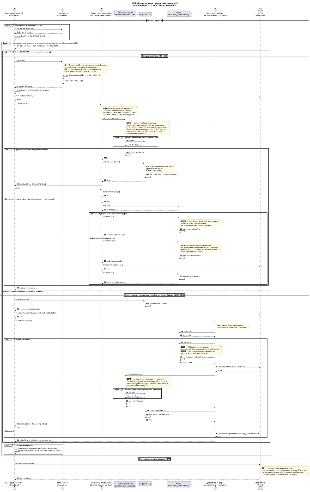
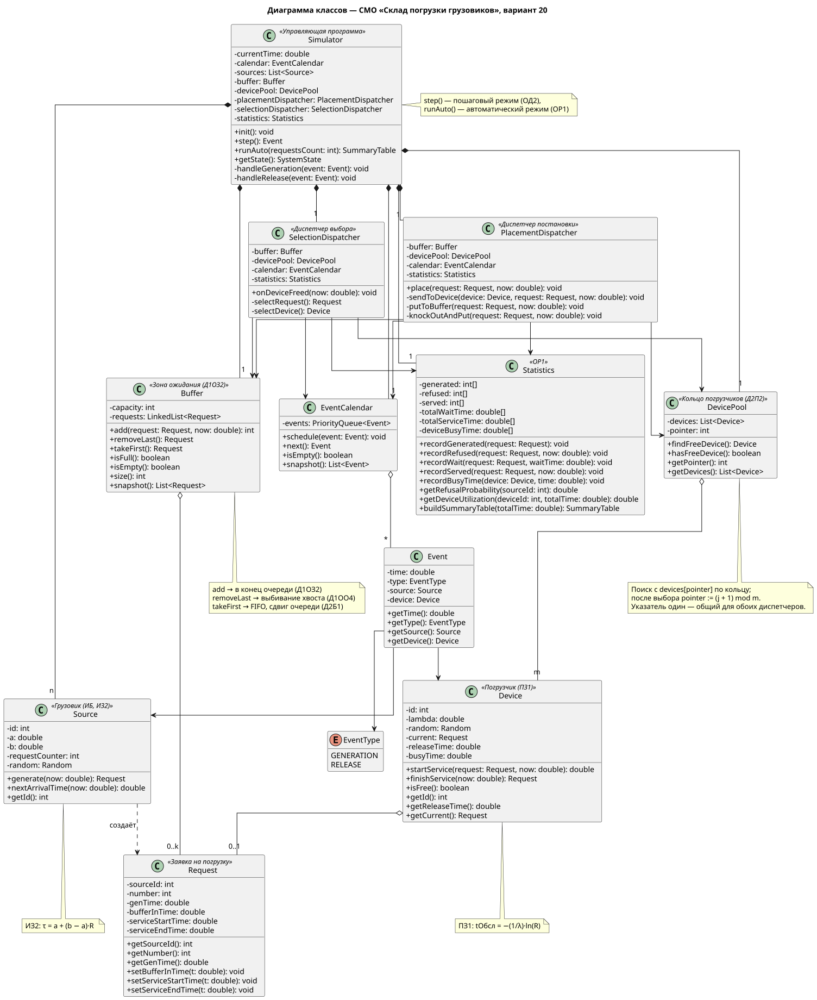
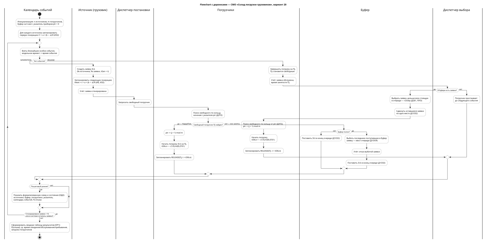
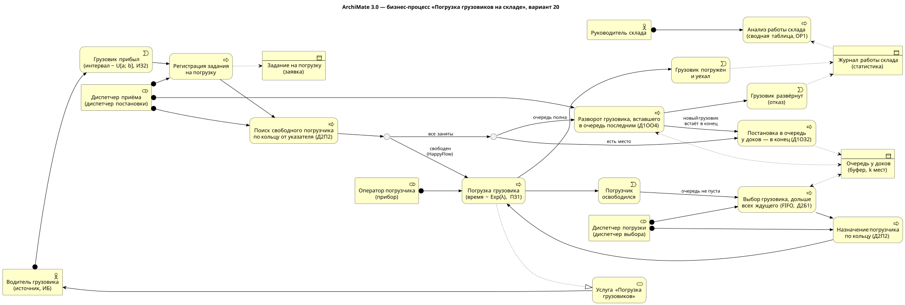

# СМО «Складская система погрузки грузовых автомобилей» — вариант 20

Курсовая работа «Методы имитационного моделирования».
Выполнил: Груздев Иван Сергеевич, гр. 5130904/40106.

Этап 2 — **первичные артефакты**: sequence-диаграмма, диаграмма классов, flowchart с дорожками, бизнес-процесс в ArchiMate 3.0.

## Код варианта

| ИБ | ИЗ2 | ПЗ1 | Д1ОЗ2 | Д1ОО4 | Д2П2 | Д2Б1 | ОР1 | ОД2 |
|----|-----|-----|-------|-------|------|------|-----|-----|

## Бизнес-домен

Грузовики приезжают на склад за погрузкой и формируют заявки. Погрузчиков меньше, чем может одновременно приехать машин, поэтому у доков есть зона ожидания (буфер) ограниченной вместимости. Если зона ожидания заполнена, разворачивается грузовик, вставший в очередь последним, а на его место встаёт вновь прибывший.

| Элемент СМО | Сущность бизнес-домена |
|---|---|
| Источник | Грузовой автомобиль, прибывающий на склад |
| Заявка | Задание на погрузку конкретного грузовика |
| Буфер | Зона ожидания у доков (k мест) |
| Прибор | Погрузчик |
| Диспетчер постановки | Диспетчерская служба приёма грузовиков |
| Диспетчер выбора | Диспетчер распределения погрузки |
| Отказ | Развёрнутый грузовик |
| Выход из системы | Погруженный и уехавший грузовик |

## Расшифровка варианта

| Код | Значение | Реализация в модели |
|---|---|---|
| **ИБ** | Бесконечный источник | После генерации заявки источник сразу планирует следующую |
| **ИЗ2** | Равномерный закон поступления заявок | Интервал τ = a + (b − a)·R, R ∈ [0; 1) |
| **ПЗ1** | Экспоненциальный закон времени обслуживания | tОбсл = −(1/λ)·ln(R) |
| **Д1ОЗ2** | Постановка в буфер в порядке поступления | Заявка встаёт в конец очереди; при уходе заявки из буфера оставшиеся сдвигаются к началу |
| **Д1ОО4** | Отказ: последняя поступившая в буфер | При полном буфере выбивается хвост очереди (заявка, меньше всех простоявшая), отказ засчитывается выбитой заявке; новая встаёт в конец |
| **Д2П2** | Выбор прибора по кольцу | Поиск свободного погрузчика начинается с указателя ptr; после постановки ptr := (j + 1) mod m |
| **Д2Б1** | Выбор заявки из буфера — FIFO | Выбирается голова очереди (дольше всех ожидающая заявка) |
| **ОР1** | Автоматический режим — сводная таблица | По источникам: сгенерировано, отказов, P(отказа), ср. время ожидания/обслуживания/пребывания; по погрузчикам — коэффициент загрузки |
| **ОД2** | Пошаговый режим — формализованная схема и текущее состояние | Источники, буфер, погрузчики, указатель, календарь событий, % отказа на каждом шаге |

## Принятые проектные решения

1. **Диспетчер постановки может поставить заявку сразу на погрузчик**, минуя буфер (если свободный погрузчик есть). Если все заняты — работает с буфером.
2. **Указатель кольца Д2П2 один** и хранится в `DevicePool`. Оба диспетчера ищут прибор через `DevicePool.findFreeDevice()`, поэтому состояние указателя всегда согласовано.
3. **Триггеры диспетчеров** (особые события из календаря):
   - `GENERATION` — заявка сгенерирована → `PlacementDispatcher.place()`;
   - `RELEASE` — погрузчик освободился → `SelectionDispatcher.onDeviceFreed()`.
4. Приборы не отказывают — они бывают только заняты. Отказ возможен только в буфере (Д1ОО4).
5. **Порядок одновременных событий.** Если освобождение погрузчика и прибытие грузовика приходятся на один момент модельного времени, сначала обрабатывается `RELEASE`, затем `GENERATION`. Так освободившееся место используется раньше, чем принимается решение об отказе, и не возникает лишнего выбивания по Д1ОО4. Законы ИЗ2 и ПЗ1 непрерывные, поэтому точное совпадение маловероятно, но правило делает работу календаря событий детерминированной.

## Артефакты

### Sequence-диаграмма

Одна диаграмма с `alt`/`loop` охватывает все сценарии:
- **HappyFlow** — есть свободный погрузчик, заявка сразу встаёт на обслуживание;
- **постановка в буфер** — погрузчики заняты, в буфере есть место (Д1ОЗ2);
- **выбивание** — погрузчики заняты, буфер полон (Д1ОО4);
- **выборка из буфера и постановка на прибор** при освобождении погрузчика (Д2Б1, Д2П2).

Исходник: [`docs/sequence.puml`](docs/sequence.puml)



### Диаграмма классов

Исходник: [`docs/class.puml`](docs/class.puml)



### Flowchart с дорожками

Исходник: [`docs/flowchart.puml`](docs/flowchart.puml)



### Бизнес-процесс в нотации ArchiMate 3.0

Бизнес-уровень: участники и роли (водитель, диспетчер приёма, диспетчер погрузки, оператор погрузчика, руководитель склада), события, процессы с развилками по варианту, бизнес-объекты (задание, очередь у доков, журнал) и услуга «Погрузка грузовиков».

Исходник: [`docs/archimate.puml`](docs/archimate.puml)



## Как пересобрать картинки

```bash
java -jar plantuml.jar -charset UTF-8 -tsvg -o img docs/*.puml
java -jar plantuml.jar -charset UTF-8 -tpng -o img docs/*.puml
```
